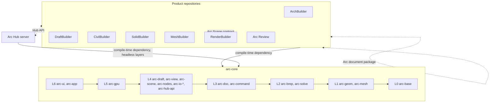

# Arc

> **Status: design phase.** No builds are available yet. This repository contains the product definition, architecture and roadmap that implementation follows.

Arc is an open-source suite of native desktop applications and one collaboration server for designing
buildings, infrastructure, products and 3D content. This repository holds what all Arc repositories
share: vision, product map, suite architecture, engineering standards, governance, architecture
decisions and the roadmap.

## What Arc is

Every Arc application is written in Rust end to end and is built on one shared foundation,
`arc-core`. Each application works fully offline, with no account and no license server.
Collaboration is added by connecting to a self-hosted Arc Hub. Open formats (IFC, DWG/DXF, STEP,
glTF, OpenUSD, LandXML, BCF, PDF) are first-class, and native documents are documented and readable
without Arc.

## Products

| Product | Scope | Repository |
|---|---|---|
| ArchBuilder | BIM authoring for architecture, structure and building services, with concept massing and steel detailing | [archbuilder](https://github.com/ACKaraca/archbuilder) |
| DraftBuilder | 2D drafting and 3D CAD on the DWG/DXF data model, with optional discipline toolsets | [draftbuilder](https://github.com/ACKaraca/draftbuilder) |
| CivilBuilder | Civil infrastructure: survey, terrain, alignments, corridors, grading, networks and swept paths | [civilbuilder](https://github.com/ACKaraca/civilbuilder) |
| SolidBuilder | Parametric solid and surface modeling, assemblies, drawings, manufacturing and simulation | [solidbuilder](https://github.com/ACKaraca/solidbuilder) |
| MeshBuilder | Polygon and subdivision modeling, sculpting, texturing, rigging, animation and effects | [meshbuilder](https://github.com/ACKaraca/meshbuilder) |
| RenderBuilder | Physically based production renderer, look development and render-farm worker | [renderbuilder](https://github.com/ACKaraca/renderbuilder) |
| Arc Review | Model and drawing viewing, federation, clash detection, 4D/5D, quantity takeoff, markup and XR review | [arc-review](https://github.com/ACKaraca/arc-review) |
| Arc Hub | Self-hostable collaboration server: common data environment, product data, production tracking, automation API | [arc-hub](https://github.com/ACKaraca/arc-hub) |
| Foundation | Shared Rust crates used by every product | [arc-core](https://github.com/ACKaraca/arc-core) |

The boundaries between products are defined in [docs/products.md](docs/products.md).

## Principles

1. **Native Rust end to end.** No web view shell and no JavaScript or TypeScript in desktop applications.
2. **One foundation, many products.** Geometry, storage, commands, rendering, UI kit and interchange live once in `arc-core`.
3. **The document is the authority.** Views, sheets, schedules, scenes and exports are derived from one semantic model.
4. **Everything is a command.** Every change is a typed, validated, undoable command, whoever issues it.
5. **Offline first, account free.** Collaboration through Arc Hub is optional.
6. **Open formats first.** Imports preserve what they cannot model and report every loss.
7. **Never lose work, never crash.** Hostile-input discipline, crash-safe storage, old files always open.
8. **Fast by construction.** Performance budgets are part of acceptance.
9. **Automatable everywhere.** One automation protocol, a headless CLI per application, scripting, node graphs, sandboxed plug-ins.
10. **Accessible and localized from the first release.**
11. **Simple until proven otherwise.** Abstractions arrive with their second concrete user.

Each principle and its consequences are set out in [docs/vision.md](docs/vision.md).

## Architecture at a glance

Products depend on `arc-core` and never on each other. At run time they cooperate through three
contracts: the Arc document package, the Arc Scene contract and the Hub API. Every application also
exposes the Arc Automation Protocol to scripts and tools. See
[docs/architecture/overview.md](docs/architecture/overview.md) and
[docs/architecture/contracts.md](docs/architecture/contracts.md).

## Repository map

| Path | Contents |
|---|---|
| [docs/vision.md](docs/vision.md) | Purpose, users, principles, non-goals, success criteria |
| [docs/products.md](docs/products.md) | Product map, boundaries, hand-offs, responsibility matrix |
| [docs/architecture/](docs/architecture/overview.md) | Suite architecture, contracts, interoperability, collaboration, automation, user experience |
| [docs/engineering/](docs/engineering/repository-standards.md) | Agent rules, repository, coding, testing, dependency, clean-room, documentation, issue and release standards |
| [docs/adr/](docs/adr/README.md) | Suite architecture decision records |
| [docs/rfcs/](docs/rfcs/README.md) | Process for suite-wide change proposals |
| [docs/roadmap.md](docs/roadmap.md) | Suite phases 0 to 5 and exit criteria |
| [docs/glossary.md](docs/glossary.md) | Suite vocabulary |
| [CONTRIBUTING.md](CONTRIBUTING.md) | Contribution guide for every Arc repository |
| [GOVERNANCE.md](GOVERNANCE.md) | Roles and decision making |
| [CODE_OF_CONDUCT.md](CODE_OF_CONDUCT.md) | Community standards |
| [TRADEMARKS.md](TRADEMARKS.md) | Use of the project's names and logos |
| [SECURITY.md](SECURITY.md) | Reporting vulnerabilities |

## Roadmap

| Phase | Theme | Focus |
|---|---|---|
| 0 | Foundation | `arc-core` document, command, viewport and UI layers; a reference shell application; CI and release pipeline |
| 1 | First usable products | DraftBuilder 2D core; Arc Review viewer |
| 2 | Building design and collaboration | ArchBuilder architectural core; Arc Hub documents module with web viewer; DWG write |
| 3 | Engineering breadth | SolidBuilder; CivilBuilder; clash detection, 4D and takeoff; Hub product data |
| 4 | Visualization and content | RenderBuilder; MeshBuilder; ArchBuilder structure and building services; DraftBuilder toolsets; Hub production tracking |
| 5 | Depth and scale | Element-level multi-user editing; manufacturing and simulation; XR review; GPU path tracing; assistant workflows |

Phases end on exit criteria, not dates. See [docs/roadmap.md](docs/roadmap.md).

## Getting involved

Arc is defined in the open before it is built. Useful contributions now are reviews of the
architecture and decisions, domain expertise on professional workflows, and contributor-owned test
files for the interchange corpora. Start with [CONTRIBUTING.md](CONTRIBUTING.md); every change
starts from an issue. Suite-wide proposals follow the [RFC process](docs/rfcs/README.md).

## License

Licensed under the [Apache License, Version 2.0](LICENSE). Copyright ACKaraca and the Arc
contributors. Contributions are accepted under the same license with a Developer Certificate of
Origin sign-off; see [CONTRIBUTING.md](CONTRIBUTING.md).

## Trademarks

Arc, ArchBuilder, DraftBuilder, CivilBuilder, SolidBuilder, MeshBuilder, RenderBuilder, Arc Review and Arc Hub are names of this project and are not covered by the Apache License; see the [trademark policy](https://github.com/ACKaraca/arc-suite/blob/main/TRADEMARKS.md). All other product and company names are trademarks of their respective owners and are used only to describe scope and interoperability.
