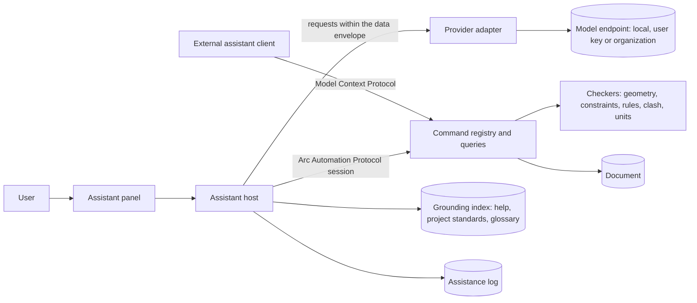
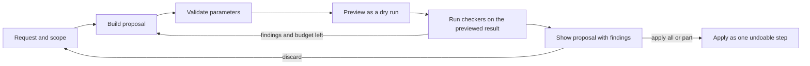

# Assistance

How optional AI assistance works in every Arc application: the levels of assistance, the tool
surface an assistant uses, grounding and citations, deterministic validation, human control and
provenance, providers and deployment, data handling, budgets, evaluation, safety for engineering
content and languages. The decisions are recorded in
[ADR-0014](../adr/0014-assistance-is-optional-and-provider-neutral.md),
[ADR-0019](../adr/0019-assistance-levels-grounding-and-deterministic-checking.md) and
[ADR-0020](../adr/0020-assistant-provenance-and-command-policy.md); the command model and protocol
it builds on are in [automation and assistance](automation-and-assistance.md).

## Principles

1. **The assistant is a client, not a component of the model.** It reads and changes a document only
   through the Arc Automation Protocol, with the commands, queries, permissions and roots any script
   has. There is no assistant-only write path.
2. **The engines decide, the assistant proposes.** Every proposed change is checked by the
   product's deterministic engines before the user sees it. The assistant is never the checker of
   record for geometry, constraints, codes, clashes, quantities or units.
3. **Answers come from the project.** The assistant answers from the open document, the product's
   own help and the project's standards, and cites the objects and rules it used.
4. **A person applies and a person signs.** Changes apply only through a user action or a budgeted
   run the user started, each as one undoable step with a provenance mark. Release, sign-off and
   approval stay with the professional.
5. **Nothing depends on it.** With no provider configured the panel is absent and every workflow
   works by hand and by script ([ADR-0014](../adr/0014-assistance-is-optional-and-provider-neutral.md)).

## Components

| Component | Role | Location |
|---|---|---|
| Assistant panel | Conversation, proposal review, send preview, settings | `arc-app`, built with `arc-ui` |
| Assistant host | Holds the conversation and proposals, runs the tool loop, enforces level, scope, data envelope and budgets | `arc-app`; runs on worker threads, never on the UI thread |
| Provider adapter | Translates the host's tool loop to one documented model API style; holds no state | `arc-app`; the supported API styles are documented with the host in `arc-core` |
| Automation session | The host's protocol session with the product, with a declared permission set and roots | `arc-command` |
| Checkers | Deterministic validation engines exposed as read-only commands | Each product and `arc-core` |
| Grounding index | Local index of the product help, command catalog, glossary and the project's standards | Built on the user's machine |
| Assistance log | Local record of requests, data sent, tool calls, proposals and outcomes | The user's application data folder |

An external assistant client may drive a product through the Model Context Protocol endpoint
instead of the panel. It meets the same permissions; when attached to a running application its
edits run as previews and apply only after the user approves them in the application.

## Levels of assistance

A session runs at one level, chosen by the user per request or as a default per project. A higher
level includes the lower ones.

| Level | Name | What the assistant may do | What it may not do | User control |
|---|---|---|---|---|
| A1 | Explain and search | Read the document through queries, read the selection, render views, run checkers, search help and project standards, answer with citations, explain commands, select objects for the user to look at | Change the document, run commands with side effects, write files | None needed beyond the send preview |
| A2 | Propose with preview | Everything in A1; build a proposal of commands, run it as a dry run, run the checkers on the previewed result and revise it | Apply anything | The user reviews and applies, applies part, or discards |
| A3 | Act under approval | Everything in A2; apply an approved proposal and continue with the next step of a multi-step task, each step shown before it applies | Apply a step the user has not approved; widen its scope | One approval per step, or one approval for a plan whose steps stay inside the approved scope and budget |
| A4 | Batch and agent runs | Everything in A3 over a declared set of documents or objects, headless or in the application, within a declared budget, producing results as a reviewable package | Commit to a released or shared state; exceed the budget; run outside the declared roots | The user starts the run with its scope and budget, watches progress, stops it, and reviews the result before it merges |

Rules for every level:

- **Read-only by construction at A1.** An A1 session is opened with the `read` permission class
  only, so a misbehaving model cannot change the document even if the host had a fault.
- **Scope.** A request carries a scope: the selection, a level or storey, a layer, a view, a set of
  documents. Objects outside the scope, and objects the user marks as protected, are read-only for
  the proposal; a proposal that would change them is rejected by the host before preview. A
  proposal that deletes objects lists every deleted object before apply.
- **Base revision.** A proposal is bound to the revision it was previewed on and applies with
  `expectedRevision`. If the document changed, the host previews it again and shows the new
  result, or reports a conflict; a proposal is never rebased silently.
- **A4 output.** A batch run writes into a copy, a branch or a Hub draft, never into the released
  state; merging the result is a separate user action with its own review.

## Tool surface

The assistant's tools are the automation surface, unchanged. Products add tools only by adding
commands, queries and checkers that every client can use.

| Tool | Protocol method or command | Level |
|---|---|---|
| Discover commands and their parameter schemas | `command.list`, `command.describe` | A1 |
| Validate parameters without running | `command.validate` | A1 |
| Query objects, properties, references | `query.objects`, `query.references` and the later object, comparison and derived-data queries | A1 |
| Read diagnostics | `query.diagnostics` | A1 |
| Read history | `query.history` | A1 |
| Read and set the session selection | `selection.get`, `selection.set` | A1 |
| Render a view as an image | `view.render` | A1 |
| Run a checker | Read-only checker commands of the product (rule sets, clash tests, audits) | A1 |
| Read a loss report | Read-only commands that return the loss report of an import or export | A1 |
| Search help and project standards | Host function over the grounding index | A1 |
| Preview a command or a group | `command.run` with `preview: true` | A2 |
| Apply an approved proposal | `command.run` inside one transaction group, with `expectedRevision` | A3 |
| Undo the last applied proposal | `history.undo` | A3 |
| Run over several documents | Headless CLI sessions or Hub jobs with declared roots | A4 |

- **Schemas are the contract.** The model sees each command's parameter schema, with units and
  ranges, generated from the registry. A value the schema rejects never reaches `run`.
- **Command policy.** Each command carries an assistant policy (allowed, confirm each call, never)
  derived from its side-effect class and set by its author
  ([ADR-0020](../adr/0020-assistant-provenance-and-command-policy.md)). Commands that change
  permissions, automation or assistance settings, credentials, release state or signatures are
  never available to an assistant.
- **Scripts are proposals.** An assistant may draft a script, a macro, a node graph or a rule set.
  A drafted script is shown as source, passes the product's static check, and runs only when the
  user starts it from the script panel, under the script's own permissions.

## Grounding and citations

An answer or proposal is grounded when every factual statement about the project traces to a
source the user can open.

| Source | Reached through | Cited as |
|---|---|---|
| The open document | Queries, selection, rendered views | Object identifier and name, a link that selects the object |
| Derived results | Schedules, quantities, checker findings, loss reports, computed at a named revision | The result and the revision it was computed from |
| The product's help | The command catalog, help pages and glossary, shipped with the product and indexed locally | Help page or command identifier |
| The project's standards | Rule sets, templates, layer and style standards, design criteria, information requirements attached to the project | Standard, rule identifier and clause |
| Documents the user attaches | A specification, a data sheet, a brief, a photograph, added explicitly to the conversation | The attachment and its page or region |

- A statement without a source is labeled as general knowledge, and is never used as a value in a
  proposal without the user confirming it.
- Numbers about the project in an answer come from a query or a checker, not from the model's
  arithmetic; the host computes sums, counts and conversions and the answer cites the query.
- Citations are live: selecting a cited object selects it in the viewport and the property grid; a
  citation to an object that no longer exists is shown as stale.
- The grounding index is built and searched on the user's machine. When an embedding model is used
  for search, it follows the same provider and data-envelope rules as the conversation.

## Validation loop

1. **Parameters.** The registry validates every invocation against its schema; violations return
   to the assistant with JSON pointers.
2. **Preview.** The proposal runs as a dry run of the document; document validators run exactly as
   for a commit, and the change summary lists created, modified and deleted objects.
3. **Checkers.** The host runs the checkers that apply to the changed objects and the request:

   | Checker family | Examples | Owner |
   |---|---|---|
   | Geometry validity | Valid solids and profiles, self-intersection, minimum feature size, closed boundaries | `arc-geom`, `arc-brep`, products |
   | Constraints | Solver status, over- and under-constrained sketches, broken references | `arc-solve`, products |
   | Rules and standards | Project rule sets, information requirements, layer and style standards, design criteria | Products |
   | Clash and interference | Hard and clearance clashes, interference between parts | Products, Arc Review |
   | Units and tolerances | Values in document units, within schema ranges, within the stated tolerance | `arc-base`, `arc-command` |
   | Domain engines | Quantities, structural and hydraulic checks, toolpath simulation, render statistics | Products |

4. **Revision.** Findings return to the assistant, which may revise the proposal within its
   budget. The number of revisions is bounded.
5. **Presentation.** The user sees the proposal with every remaining finding. A proposal is never
   presented as clean when a checker failed to run; the host states which checkers ran, at which
   revision, and which did not.

## Human control

| Control | Behavior |
|---|---|
| Send preview | Before a request leaves the machine, the panel shows what will be sent (the data classes, the objects, any images and attachments) and its size. A user can approve once per project and provider for given data classes |
| Proposal review | The proposal lists its items in plain language with their commands and parameters, highlights affected objects in every open view, and shows property changes as before and after values in document units |
| Selective accept | A proposal is made of items. The user accepts a subset; the host previews the subset again as a whole and applies it only if it is valid on its own |
| One undo step | Each accepted proposal applies as one transaction group: one step in the undo history, labeled with the request |
| Provenance marks | Transactions applied from a proposal record their origin. Objects created or changed by them carry a mark that the user clears by reviewing or editing them ([ADR-0020](../adr/0020-assistant-provenance-and-command-policy.md)) |
| Stop | Every request and run can be stopped; a stopped run applies nothing it had not already applied as approved steps |
| Audit trail | The assistance log records each request: time, provider and model, data classes and size sent, tools called, proposal identifier, outcome (applied, partly applied, discarded) and cost. Content is recorded only when the user turns content logging on. On an Arc Hub project, the same entries go to the Hub audit trail |

## Providers and deployment

| Deployment | Description | Leaves the machine |
|---|---|---|
| None | No provider configured; the panel is absent | Nothing |
| Local model | A model runtime on the same machine, reached on a loopback address the host verifies | Nothing |
| User's own provider | The user's account with a provider, configured with an endpoint and key | What the send preview shows |
| Organization endpoint | An endpoint the organization operates or contracts, set by an administrator policy or by the Arc Hub project | What the send preview shows, under the organization's policy |
| External client | An assistant application the user runs, connected through the Model Context Protocol endpoint | What that client sends; the endpoint itself sends nothing |

- **Keys.** Provider keys are stored in the operating system's credential store, never in
  documents, settings files, logs or the assistance log.
- **Capabilities.** The host reads the provider's declared capabilities (tool calling, context
  size, image input) and offers only the levels and features they support. A level that needs
  image input is not offered to a text-only model.
- **Offline.** Without a network, a configured local model keeps working; other providers show as
  unavailable and no request is queued for later sending.
- **Browser and mobile builds.** Assistance in browser and mobile builds uses a user or
  organization endpoint; on-device models are not promised.
- **Open host.** The host's instructions to the model, its tool definitions and the task suites
  are part of the open repositories. Hosted assistance services remain outside them
  ([ADR-0014](../adr/0014-assistance-is-optional-and-provider-neutral.md)).

## Data handling

| Data class | Content | Default |
|---|---|---|
| Request | The user's text and the conversation | Sent with every request |
| Catalog | Command identifiers, labels and parameter schemas; help excerpts | Sent when needed |
| Metadata | Object types, names, counts, property values of objects in scope | Sent on approval |
| Geometry summary | Bounding boxes, levels, dimensions and areas of objects in scope | Sent on approval |
| Images | Rendered views of the document | Sent on approval, per image |
| Attachments | Files the user adds to the conversation | Sent on approval, per file |
| Whole document | The complete document or exports of it | Never sent by the host |

- **Per-project opt-in.** Assistance with a non-local provider is off for a project until the user
  turns it on for that project. An organization or Hub project policy can forbid non-local
  providers or limit the data classes.
- **Redaction.** Before sending, the host removes or replaces personal data (person names, e-mail
  addresses, telephone numbers in properties), file paths and, on request, project and client
  names. Georeferenced coordinates are sent relative to a local origin unless the user allows
  real-world coordinates.
- **Untrusted content.** Text from the document, imported files, attachments and tool results is
  data. It never changes the assistant's level, scope, permissions or settings, and instructions
  found inside it are not followed.
- **No training on user data.** Arc collects no assistance data. The host requests no retention and
  no training from providers whose API offers those options, and the panel shows the retention
  terms the user or administrator recorded for the provider.
- **Logs.** The assistance log is local and bounded in size and age; the user can clear it.
  Automation logging rules apply to the host's session
  ([security boundaries](automation-and-assistance.md#security-boundaries)).

## Cost and latency budgets

| Budget | Applies to | When exceeded |
|---|---|---|
| Tool calls per request | A1 to A4 | The request ends with what it has, and says so |
| Input and output size per request | A1 to A4 | The host trims context by scope before sending; if still too large it asks the user to narrow the scope |
| Revisions per proposal | A2 to A4 | The proposal is shown with its remaining findings |
| Wall-clock time | A1 to A4 | The request ends; nothing unapproved is applied |
| Money | A4, and any request when the user sets a limit | The run stops before the call that would exceed it; prices are those the user or administrator recorded for the provider |
| Changed objects per proposal | A2 to A4 | The proposal is split or rejected |

- The panel shows the estimated and the actual use of each request.
- Previews and checkers run locally and are not counted against model budgets; a proposal's
  preview time is that of its commands.
- Targets: the panel acknowledges a request immediately, streams answer text as it arrives, and
  never blocks interaction with the document; a request may be sent to a small local model for
  search and classification and to a larger model for proposals when the user configures both.

## Evaluation

Each product keeps an assistance task suite built from its reference workflows
(`docs/product/workflows.md`). A capability is offered in the panel only when its tasks pass at
the product's stated threshold with at least one documented local configuration and one remote
configuration.

| Element | Content |
|---|---|
| Task | A fixture document, a request in English and in Turkish, the level and scope, and the capability identifier it exercises |
| Acceptance check | Deterministic: checker findings, expected object properties and counts, no change outside scope, units correct, required citations present and resolving |
| Replay mode | Model responses recorded once and replayed, so the suite runs in continuous integration without network access or cost |
| Live mode | The same tasks against a configured provider, run on demand |
| Metrics | Task success rate, proposal validity on first preview and after revisions, scope violations, unit errors, citation accuracy, cost and latency percentiles |
| Regression record | Results stored per product version, host version, provider and model, so a change in any of them is visible |

- Scope violations and unit errors have a threshold of zero: one failure blocks the capability
  regardless of other results.
- In real use, acceptance rates (applied, partly applied, discarded) are measured only on the
  user's machine and shared only when the user exports them.

## Safety for engineering content

- **Status of every value.** Values shown by the panel carry their status: from the document,
  computed by a named engine at a named revision, proposed by the assistant and not checked, or an
  assumption the user must confirm. A proposed value is never shown as verified.
- **Units.** Every value in a proposal is a quantity with a unit, validated by the command schema
  and shown in document units. A request with an ambiguous unit or tolerance is answered with a
  question, not a guess.
- **Compliance claims.** A checker result reads as "no findings by rule set R, version V, at
  revision N for the rules it contains"; the assistant never states that a design complies with a
  code or standard.
- **Professional responsibility.** Reports and exports produced with assistance carry a notice that
  the content was prepared with assistance and is subject to review by the responsible
  professional. Signing, stamping, releasing, approving reviews and issuing documents are never
  available to an assistant.
- **Calculations.** Engineering calculations are performed by the product's engines; an assistant
  may set up their inputs as a proposal and explain their results with citations.

## Accessibility and languages

- The panel meets the suite accessibility baseline
  ([user experience](user-experience.md#accessibility-baseline)): every proposal, highlight and
  finding has a text equivalent that assistive technologies announce, and every action is
  available from the keyboard.
- Requests are accepted in any language the model handles; English and Turkish are tested in every
  task suite. Answers follow the interface language unless the user asks otherwise.
- Numbers in requests are parsed by the host with the interface locale's decimal and grouping
  separators before they reach a schema; command identifiers and parameters are language
  independent.
- The product glossaries and help in each language are part of the grounding index, so terms are
  used as the product defines them.

## Assistance across products

- **One client, several applications.** An external client may hold sessions with several running
  products at once, each with its own permissions; nothing in one product depends on another.
- **Hand-off notes.** A user can export the assistant session (requests, applied proposal
  summaries, cited object identifiers) with an Arc exchange package or a Hub issue. The receiving
  product's panel opens it as context; it never applies anything by itself.
- **Identity across exchange.** Cited objects resolve in the receiving product through the
  identifiers that the exchange package and the open formats preserve; an object that does not
  resolve is shown as unresolved.
- **Hub assistance.** Arc Hub has its own administrator-configured assistance over project records,
  with server-side permission checks and audit; its capabilities are specified in the Arc Hub
  repository.

## Readiness classes

Product capability files classify each assistance capability:

| Class | Meaning |
|---|---|
| R1 | Achievable with general-purpose models through the command surface and the product's existing engines |
| R2 | Needs product engines, rule data or content that must exist first; the assistant composes their inputs and explains their outputs |
| R3 | Research-grade: listed for direction, not promised, and not scheduled until a prototype passes its task suite |
