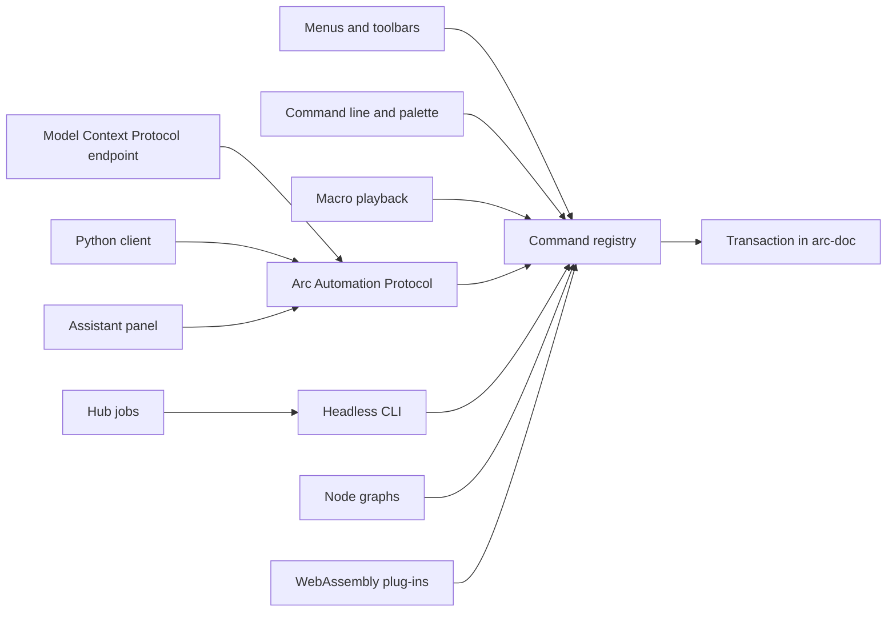

# Automation and assistance

How Arc applications are driven by anything other than direct manipulation: the command model,
the automation protocol, scripting, node graphs, plug-ins and optional assistance, and the security
boundaries around all of them.

## One command model

Every change to a document is a command defined in `arc-command`
([ADR-0006](../adr/0006-one-command-model-one-automation-protocol.md)). A command definition has:

| Element | Purpose |
|---|---|
| Stable identifier | Namespaced and permanent, for example `arch.wall.create`, `draft.line`, `core.document.save` |
| Label and description | Message identifiers resolved through the localization catalogues |
| Parameter schema | Typed parameters with units, ranges, defaults and descriptions, published as a machine-readable schema |
| Enabled predicate | Whether the command can run against the current document and selection, with a reason when it cannot |
| Non-interactive `run` | Executes from complete parameters, inside a transaction, with no user interaction |
| Interactive prompt machine | Optional; collects parameters step by step from the viewport, command line or tool options, then calls `run` |
| Side-effect class | Read-only, document change, file-system access, network access; used for permission checks |

Every entry point uses the same registry:

Consequences:

- Programmatic execution never opens a dialog. A missing parameter is a validation error, not a
  prompt.
- Every command is undoable as one step, whoever issued it.
- Macro recording records commands with their resolved parameters; a macro is a script.
- The command catalogue (identifiers, schemas, labels) is generated from the registry for
  documentation, the CLI help, the MCP tool list and tests.

## Arc Automation Protocol

JSON-RPC 2.0 over standard input and output or a local socket, specified in
[contracts](contracts.md#arc-automation-protocol). Every desktop application serves it when the user
enables automation, and every headless CLI serves it with `serve`. The same commands, parameter
schemas and error codes apply in both.

## Scripting

- Scripting is a client of the automation protocol. The official Python client is a library that
  connects to a running application or starts a headless CLI, and exposes commands as typed
  functions generated from the registry.
- Scripts run out of process. No interpreter is embedded in the first releases; embedding is
  reconsidered only if out-of-process scripting cannot meet interactive performance needs.
- A product may host a compatibility interpreter for an established customization language of its
  domain only through an ADR in its own repository. Such an interpreter invokes commands through the
  same registry and is subject to the same permission model as any other client.
- Scripts can be started from the application's script panel; the panel shows output and errors and
  can stop the script.

## Node graphs

Visual node graphs run on `arc-nodes`, a typed dataflow engine with evaluation, caching and
serialization. The same engine and editor serve parametric design in ArchBuilder, cross-section
components in CivilBuilder, procedural modeling and effects in MeshBuilder, materials in
RenderBuilder and automation rules in every product.

- Nodes are pure functions of their inputs, or command nodes that produce commands.
- A graph that changes a document does so by emitting commands that run in one transaction.
- Graphs are stored in the document and versioned like any other object.
- Products contribute domain nodes; the engine, editor and serialization are shared.

## Plug-ins

Plug-ins are WebAssembly components run by `wasmtime` ([ADR-0012](../adr/0012-extensibility.md)).

| Property | Rule |
|---|---|
| Authority | No ambient authority. A plug-in reaches the document only through command and query interfaces granted by the host. |
| Capabilities | File-system, network and clipboard access are separate capabilities, each granted explicitly by the user, scoped to paths or hosts. |
| Limits | Memory, execution fuel and wall-clock limits per call; exceeding a limit aborts the call. |
| Transactions | Changes are applied transactionally; a failed or aborted call leaves the document unchanged. |
| Packaging | A package carries a manifest: identifier, version, publisher, required host contract version, requested capabilities, contributed commands, panels and nodes. |
| Trust | The host assigns trust; a package cannot declare itself trusted. Packages from the project are signed; others run with the capabilities the user grants. |
| Native code | Native dynamic-library plug-ins are not supported. |

## Assistance

An assistant panel lets a user describe a task in natural language and have it carried out with
Arc's own commands ([ADR-0014](../adr/0014-assistance-is-optional-and-provider-neutral.md)).

- **Optional.** No product feature requires an AI service. With no provider configured, the panel is
  absent.
- **Provider neutral.** The user configures the provider: any endpoint implementing a supported,
  documented API, including models running locally.
- **Same commands.** The assistant acts only through the automation protocol, with the same command
  registry and the same permissions as a script.
- **Preview and explicit apply.** Proposed changes run as a dry run first. The user sees the commands,
  their parameters and the resulting changes highlighted in the viewport, and applies or discards
  them. Applied changes form one undoable transaction.
- **Data stays local.** No document content leaves the machine without an explicit user action. The
  panel shows what will be sent before it is sent, and the user can restrict the assistant to
  metadata, selection or nothing.
- **Outside the repositories.** Hosted assistant services are not part of the open-source
  repositories.

## Security boundaries

Automated access is treated as a threat surface from the first release.

| Boundary | Rule |
|---|---|
| Transport | The automation protocol is served only on standard input and output or a local socket owned by the current user, never on a network interface. |
| Enablement | A running desktop application serves the local socket only when the user enables automation; the setting is per user and visible in the status bar while a client is connected. |
| Session permissions | A client declares requested permissions in `initialize` (read only, document change, file-system paths, network). The user approves them once per client identity; the application enforces them on every call. |
| File access | File-system access by commands invoked through automation is confined to approved read and write roots. Paths are canonicalized and checked against the roots; escape attempts are rejected and logged. |
| Side-effect classes | Commands classed as file-system or network access are refused unless the session holds the matching permission. |
| Headless CLI | The CLI accepts `--read-root` and `--write-root` options; without them it may read only its input files and write only its declared outputs. |
| Hub jobs | Jobs run the CLI with a service-account token scoped to the project, in a temporary working directory, with roots limited to that directory. |
| Plug-ins | Sandboxed as described above; plug-ins never receive automation-protocol credentials. |
| Assistants | Treated as automation clients with the user's chosen permission set; content returned by a model is data and never executed as code outside the command registry. |
| Logging | Automation calls are logged locally with client identity, command and outcome; parameter values that may hold personal data are not logged. |

These boundaries limit damage from a faulty or malicious client; they are not a substitute for the
operating system's own account security.
