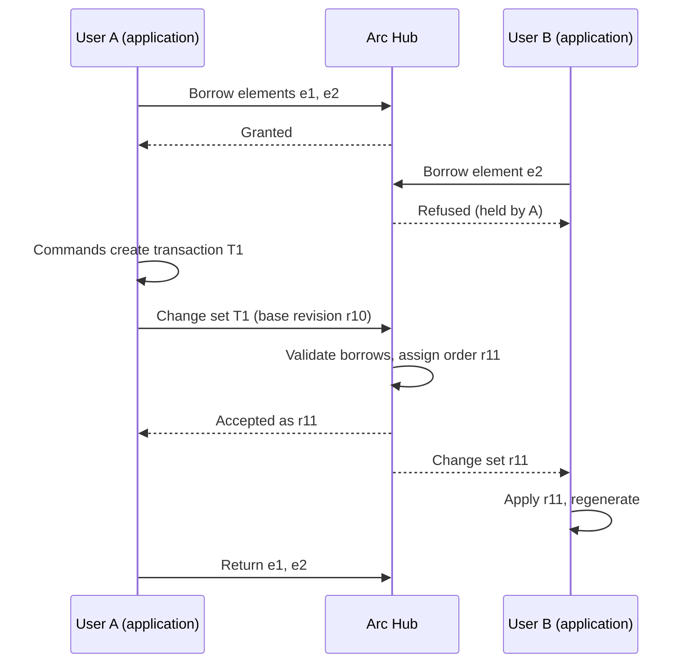

# Collaboration

How Arc users work together: offline first, with Arc Hub as an optional server, introduced in two
stages ([ADR-0011](../adr/0011-collaboration-offline-first-hub-optional-staged-multi-user.md)).

## Offline first

- Every application is complete without Hub. A user without a network connection opens, edits,
  saves, exports and plots.
- Collaboration starts when a user connects a project folder to a Hub project. Disconnecting never
  makes local documents unusable.
- Work done offline is never discarded on reconnection. It is uploaded as a new version (stage 1) or
  as queued change sets (stage 2); conflicts are resolved by keeping both versions.
- Hub holds no data that a desktop application needs to open a document. Issue and review data that
  originates in Hub is cached locally and readable offline.

## Arc Hub in brief

Arc Hub is a single Rust server: axum for HTTP and WebSocket, PostgreSQL for metadata, S3-compatible
object storage or a file system for content, OpenID Connect for sign-in. Its browser client is
server-rendered and embeds the Arc Review viewer compiled to WebAssembly. Deployment is self-hosted;
the server runs as one process or a small set of processes (web, job workers) from the same binary.

## Stage 1: file-level collaboration

| Capability | Behavior |
|---|---|
| Versions | Each upload of a document creates an immutable version with author, time, comment and checksum. Any version can be downloaded, viewed in the browser and compared with another version. |
| Check-out | A user checks out a document to obtain an exclusive edit lock. Others can open it read-only and see who holds the lock. Check-in uploads a new version and releases the lock. Locks are visible offline from the last synchronization and can be broken by a project manager, which keeps the lock holder's local work and records the event. |
| Lifecycle states | Documents move through configurable states, with ISO 19650 states (work in progress, shared, published, archived) as the default configuration. State transitions are permission-checked and audited. |
| Reviews and approvals | A reviewer set, a due condition and a decision per reviewer; approval moves the document to the next state. Reviews attach markups and issues to the exact version reviewed. |
| Issues | Issues carry a title, description, assignee, status, viewpoint (camera, section planes, visibility), element identifiers and attachments. They are exchanged through BCF and the BCF API. |
| Web viewing | Models and drawings are viewed in the browser without installing an application; markups and issues are created there. |
| Desktop sync | A desktop application lists Hub projects, downloads and caches versions, and shows document state and issues in the application. |

Stage 1 needs no change to the document model: a version is a document package or interchange file.

## Stage 2: element-level multi-user editing

Several users edit one model at the same time. The design rests on the operation journal of the
document model ([ADR-0004](../adr/0004-document-model-typed-objects-stable-ids-transactions-operation-journal.md)).

**Element borrowing.** Before modifying an element, the application borrows it from Hub. Borrowing
is automatic when the user starts a command that modifies the element and can be done explicitly for
a set of elements or a work area. A borrowed element can be modified only by its borrower. New
elements are owned by their creator until the first synchronization. Borrows are returned on
synchronization, on request, or by a project manager.

**Change sets.** A committed transaction becomes a change set: the element-level operations from the
journal (create, modify and delete with before and after state), the identifier of the command that
produced it, the author and the base revision.

**Ordering by the server.** Hub assigns each accepted change set the next project revision. The
server's order is the only order; every client applies change sets in that order. Hub validates that
each modified element was borrowed by the sender and that the base revision is compatible.

**Regeneration.** Derived data is not transmitted. Each client regenerates from the model after
applying change sets, so clients never disagree about derived data computed from the same revision.

**Offline editing in stage 2.** A user who loses the connection keeps editing the elements already
borrowed and may create new elements. Changes to elements that were not borrowed are kept locally as
pending change sets marked unconfirmed.

### Conflict policy

A conflict never discards work.

1. A change set that touches only borrowed elements and new elements is accepted.
2. A pending change set that touches an element modified by someone else in the meantime is not
   applied to the shared model. The client keeps the user's version of each affected element as an
   alternate in a personal branch and shows both versions side by side.
3. The user resolves each conflict by choosing one version, merging properties, or keeping both as
   separate elements. The resolution is a new command and is recorded like any other change.
4. Unresolved alternates remain available indefinitely; they are never deleted automatically.

### What is deliberately not done

Arc does not use CRDTs for model data. Building, civil and mechanical models carry invariants that
span many elements (a wall and its hosted openings, an assembly and its constraints, a corridor and
its sections). Merging concurrent edits automatically at the data-structure level produces models
that are well formed as data but invalid as designs, and silently. Borrowing plus server ordering
keeps every accepted state valid, keeps conflicts rare and visible, and reuses the transaction
journal that undo and history already require. The decision is reopened only if borrowing proves
unworkable for a documented, frequent workflow.

## Branching and merging of model data

- A Hub project can hold named branches of a model, for example for design options or a
  competition variant. A branch starts at a project revision.
- Merging compares the branch with its target using stable identifiers: a three-way comparison at
  element and property level against the common ancestor revision.
- Changes on one side only are applied. Changes to the same property on both sides are conflicts
  resolved by the conflict policy above.
- Comparison results are viewable as a model diff (added, removed, modified elements, highlighted in
  the viewport) and exportable as structured data.
- Branches and merges are recorded in project history; every merge is itself a revision.

## Identity and permissions

- **Identity:** users sign in through OpenID Connect against the organization's identity provider;
  user and group provisioning through SCIM is supported. Hub keeps no passwords when an external
  provider is configured. Desktop applications use the authorization-code flow with PKCE and store
  tokens in the operating system's credential store.
- **Roles:** permissions are granted to users and groups per project and per folder. Default roles
  are viewer, commenter, editor, manager and administrator; each role is a named set of permissions
  that a server administrator can adjust.
- **Enforcement:** the server checks every request. Desktop applications show what the user may do,
  but enforcement never depends on the client.
- **Audit:** every state change, permission change, download, lock break and merge is recorded with
  user, time and object.
- **Automation identities:** jobs and integrations use service accounts with scoped tokens; a token
  never carries more permission than the account that created it.
