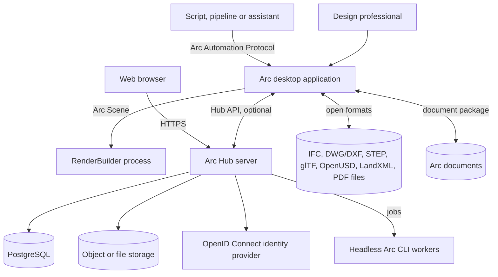
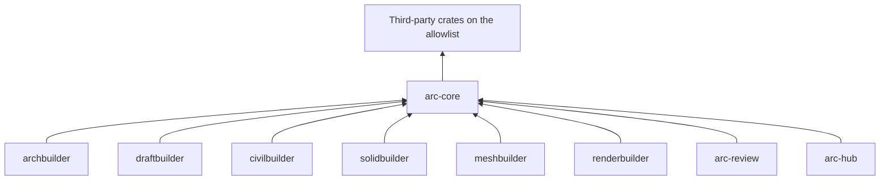
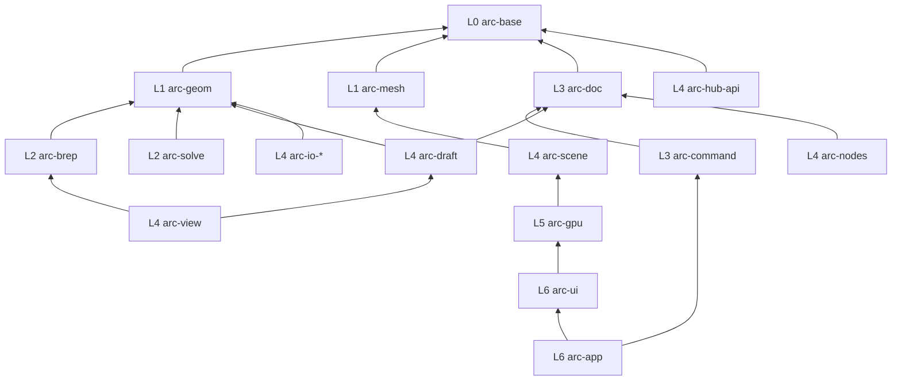
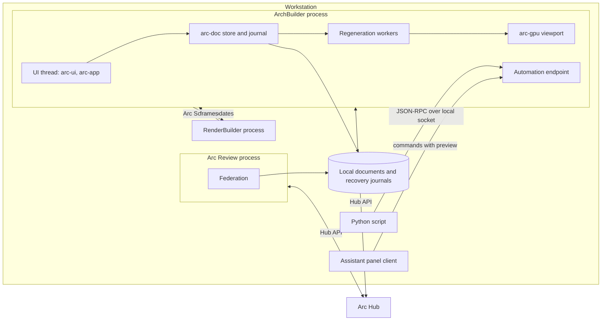

# Architecture overview

The suite architecture: system context, repository topology and its dependency rule, the layers of
`arc-core`, the product repository template and the run-time picture of a workstation. Each
product's own architecture document builds on this one.

## System context



An Arc desktop application is complete on its own: it reads and writes documents and interchange
files on the local file system. Connecting to Arc Hub adds sharing, versions, reviews and multi-user
editing. RenderBuilder runs as a separate process whenever a product requests photoreal output.
Scripts, pipelines and assistants drive applications through the automation protocol.

## Repository topology

The suite is a polyrepo ([ADR-0001](../adr/0001-polyrepo-with-one-foundation-and-a-single-suite-baseline.md)):

| Kind | Repositories |
|---|---|
| Suite | `arc-suite`: vision, architecture, standards, governance, suite ADRs, roadmap, reusable CI workflows |
| Foundation | `arc-core`: every shared crate, released as a whole under one version tag |
| Products | `archbuilder`, `draftbuilder`, `civilbuilder`, `solidbuilder`, `meshbuilder`, `renderbuilder`, `arc-review`, `arc-hub` |
| Corpora | `arc-corpus-<domain>` repositories of interchange test files, created when the first importer of the domain lands |

### Dependency rule



- Product repositories depend on `arc-core` and on third-party crates only.
- Products never depend on each other at compile time. They cooperate at run time through files and
  three contracts: the Arc document package, the Arc Scene contract and the Hub API
  ([contracts](contracts.md)).
- `arc-core` never depends on a product.
- Corpora are never Cargo dependencies; tests locate them by path and pinned commit.

### Suite baseline

`arc-core` is released as a whole under one tag. Every product pins exactly one `arc-core` tag, and a
suite release names the single tag all its products ship on; products never ship on different
foundation revisions within one suite release. Crates are consumed as tagged git dependencies;
publishing to crates.io waits until an API is declared stable. Local development uses side-by-side
checkouts with a Cargo `[patch]` override. Procedures are in
[repository standards](../engineering/repository-standards.md#suite-baseline-and-the-arc-core-pin).

## arc-core layers

`arc-core` is organized in layers. A crate depends only on crates in lower layers. Layers L0 to L4
never depend on windowing, GPU or UI crates and must build headless: for CLI tools, Hub workers,
tests and, where practical, WebAssembly. A workspace task (`cargo xtask layers`) enforces the table.
A crate is created when it is first needed.

| Layer | Crates | Responsibility |
|---|---|---|
| L0 | `arc-base` | Stable identifiers, units and quantities, tolerances, error types, color, math aliases |
| L1 | `arc-geom`, `arc-mesh` | Analytic curves and surfaces, NURBS, intersections, 2D regions, triangulation, TIN, spatial indexes; polygon meshes, subdivision, mesh booleans |
| L2 | `arc-brep`, `arc-solve` | Boundary-representation solids with persistent naming; geometric constraint solving and the unit-aware expression engine |
| L3 | `arc-doc`, `arc-command` | Document store, transactions, operation journal, dependency graph, document package; command registry, prompt machines, automation protocol endpoint, headless runner |
| L4 | `arc-draft`, `arc-view`, `arc-scene`, `arc-nodes`, `arc-io-*`, `arc-hub-api` | Shared 2D drafting model; derived views; renderable scene and the Arc Scene contract; node-graph engine; one crate per format family; Hub API types and client |
| L5 | `arc-gpu` | Real-time viewport renderer on wgpu |
| L6 | `arc-ui`, `arc-app` | Widget kit on egui; application shell |

Format crates produce a neutral model of the format; **the product owns the mapping** into its
domain model. Crate-level design, the technology choices and their versions are maintained in
[arc-core](https://github.com/ACKaraca/arc-core) and its
[technology baseline](https://github.com/ACKaraca/arc-core/blob/main/docs/architecture/technology-baseline.md).



The diagram shows representative edges, not every dependency; the layer rule is the constraint.

## Product repository template

```text
<product>/
  crates/
    <product>-model/     domain objects, rules, regeneration (headless)
    <product>-commands/  user-level commands on the model (headless)
    <product>-io/        mapping between the domain model and interchange formats (headless)
    <product>-ui/        tools, panels, viewport interaction (egui)
  apps/
    <product>/           desktop application (wiring only)
    <product>-cli/       headless CLI: convert, validate, run commands, serve the automation protocol
  docs/
  xtask/
```

The layer rule extends into products: `-model`, `-commands` and `-io` are headless and never depend
on `-ui`, windowing or GPU crates; `apps/<product>` wires the crates together and contains no domain
logic. A product adds a crate only for a real second boundary, such as a solver or a toolset. Arc Hub
follows the same rule with a server binary in place of the desktop application.

## Run-time picture of a workstation



| Process | Role | Failure isolation |
|---|---|---|
| Desktop application | Owns one or more open documents; UI on the main thread, regeneration and I/O on worker threads | A fault inside a command restores the document; the recovery journal protects unsaved work if the process ends |
| RenderBuilder | Started on demand by a product, receives an Arc Scene and streamed updates, returns frames over local IPC; also runs stand-alone or as a farm worker | A renderer fault never affects the host application or its document |
| Automation clients | Scripts, the official Python client, pipeline tools and the assistant panel connect over stdio or a local socket | Clients hold no document state; every change is a validated command |
| Headless CLI | Same model and commands as the desktop application, without UI; used locally and by Hub jobs | One process per job |
| Arc Hub | Remote or on-premises server; applications connect only when the user signs in | Applications remain fully functional when Hub is unreachable |

### Main flow inside an application

1. A command is issued from the UI, the command line, a script or a Hub job.
2. `arc-command` validates its parameters against the command schema and its enabled predicate.
3. The command runs inside an `arc-doc` transaction; the transaction records element-level
   operations in the operation journal.
4. The dependency graph marks dependent derived data stale and schedules regeneration on worker
   threads; each result carries the document revision it was computed from and a stale result is
   never applied ([ADR-0007](../adr/0007-regeneration-dependency-graph-and-revision-tagged-background-work.md)).
5. Views, the viewport and open panels update from the regenerated data.
6. Undo and redo replay the journal; the recovery journal is written continuously; an explicit save
   commits atomically to the document package.

Threading rules, performance practice and error handling are in
[coding standards](../engineering/coding-standards.md).
