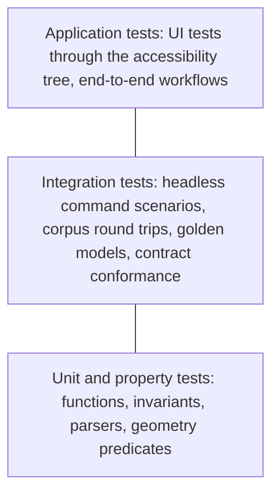

# Testing strategy

How Arc code is tested: the layers of tests, which tests each kind of change requires, the special
techniques for geometry, rendering and interchange, performance budgets, the CI gate and the policy
for flaky tests.

## Test pyramid

| Layer | Scope | Tools | Runs |
|---|---|---|---|
| Unit | A function or type in isolation | Rust test harness via `cargo-nextest` | Every pull request |
| Property | Invariants over generated inputs (geometry, solvers, serialization round trips) | Property-testing crate on the allowlist | Every pull request, longer runs nightly |
| Snapshot | Structured output: loss reports, command catalogues, serialized objects, derived views as data | `insta` | Every pull request |
| Headless command scenarios | Sequences of commands against a document through the headless runner, asserting model state, undo and redo | Product test harness on `arc-command` | Every pull request |
| UI | Panels and tools driven through the accessibility tree; image snapshots of panels | `egui_kittest` | Every pull request on a software renderer |
| Image comparison | Viewport and renderer output against reference images | Perceptual difference metric maintained in `arc-core` | Every pull request (software renderer), nightly on GPUs |
| Corpus round trip | Import, export, re-import over the corpus | Corpus harness | Nightly; affected formats on every pull request touching an importer |
| Golden models | Reference models with expected measures | Golden-model harness | Every pull request for affected crates, full set nightly |
| Contract conformance | Producers and consumers of each contract | Conformance suites in owner repositories | Every pull request touching a contract, nightly across repositories |
| Fuzz | Parsers and decoders | `cargo-fuzz` | Nightly and continuous |
| Panic hunt | Every registered command called with adversarial parameters on adversarial documents | Generated test over the command registry | Every pull request |
| Benchmark | Performance budgets | `criterion` | Nightly; on request in pull requests |

## Required tests by change type

| Change | Required |
|---|---|
| Bug fix | A test that fails before the fix and passes after it |
| Crash fix | The crashing input or parameter set as a regression test; a fuzz-corpus entry if found by fuzzing |
| New command | Headless tests for parameter validation, effect, undo and redo, enabled predicate; panic-hunt coverage is automatic; UI test if it has an interactive prompt machine |
| New domain object or rule | Unit tests of invariants; regeneration test showing dependents update; serialization round trip |
| Importer or exporter | Unit tests for each mapped construct; corpus round trip; loss-report snapshot; fuzz target updated; export validated by an independent reader |
| Geometry algorithm | Property tests of its invariants; tolerance-boundary cases; golden-model check if it affects solids |
| Viewport or renderer change | Image comparison against references; reference updates reviewed visually |
| UI panel or widget | Accessibility-tree test (names, roles, keyboard operation); image snapshot |
| File-format change | Migration test from every frozen version; compatibility test that older readers refuse or open read-only as promised |
| Contract change | Conformance suite updated; compatibility test with the previous minor version |
| Performance work | Benchmark showing the effect |
| Documentation only | Link check |

## Snapshot and image-comparison testing

- Snapshots are reviewed like code. A snapshot update in a pull request is explained in its
  description.
- Snapshots are deterministic: sorted collections, fixed seeds, no timestamps, no absolute paths.
- Image comparison uses a perceptual metric with a per-test threshold; thresholds are stored with
  the reference image and changed only with justification.
- Pull-request image tests run on a pinned software renderer so results do not depend on the runner's
  GPU; nightly runs on real GPUs from more than one vendor compare against per-vendor tolerances.
- The renderer's GPU path is held to parity with its CPU reference integrator by image comparison.
- Failing comparisons publish the expected, actual and difference images as CI artifacts.

## Round-trip corpora

- Corpora live in `arc-corpus-<domain>` repositories with a ledger row per file
  ([interoperability](../architecture/interoperability.md#validation-and-corpora)).
- The round-trip harness records, per file: import diagnostics, the loss report, object counts by
  type, identifier mapping and a geometry comparison within tolerance. The record is a snapshot.
- A change that increases losses fails unless the snapshot update is approved by a maintainer.
- Exports are validated by independent readers run as separate processes.

## Golden models

- Golden models are small, purpose-built documents, owned by the project, with expected results:
  volumes, areas, topology counts, mass properties, quantities, clash counts, section outlines.
- They exercise the B-rep tier on every kernel update; the full set must pass before a kernel
  version change merges.
- Expected values are computed independently (by hand, by a second method or from the model's
  construction) and recorded with the method used.

## Fuzzing

- Every parser and decoder has a fuzz target: DXF, DWG bridge, IFC, STEP-adjacent code, glTF, OBJ,
  STL, PLY, 3MF, USD, LandXML, point clouds, BCF, PDF import, the document package, the automation
  protocol and plug-in manifests.
- Seed corpora come from the corpus repositories and from synthetic files.
- Fuzzing runs nightly with a time budget per target and continuously where infrastructure allows.
- A finding becomes a regression test in the same pull request as its fix; a finding is never closed
  without one.

## Performance budgets

- Each product's architecture document states budgets as targets with rationale, measured on named
  reference models and reference hardware classes.
- Suite-wide defaults that products refine:

| Interaction | Target | Rationale |
|---|---|---|
| Viewport navigation on the reference model | 16.7 ms per frame (60 Hz) | Navigation must feel continuous |
| Feedback of an interactive tool (rubber band, preview) | One frame | Users place geometry by eye |
| Command validation and commit of a single-object change | 100 ms | Perceived as immediate |
| Opening a document to a usable viewport | Proportional to visible content, not total size, through lazy loading | Large models must not block work |
| Autosave and recovery journal writes | Never block the UI thread for more than one frame | Saving must not interrupt work |

- Benchmarks run nightly; a regression of more than 5% against the rolling baseline opens an issue
  automatically and blocks the next release until resolved or accepted by a maintainer.

## The single CI gate

Each repository exposes one command, `cargo xtask ci`, that runs locally exactly what the pull-request
gate runs:

1. formatting check;
2. clippy on all targets with warnings as errors;
3. unit, property, snapshot, headless, UI and panic-hunt tests with `cargo-nextest`;
4. the layer check (`cargo xtask layers`);
5. `cargo deny` (licenses, bans, advisories, sources) and `cargo audit`;
6. the headless and, for lower layers, WebAssembly build checks;
7. documentation build with broken links denied, and the relative-link check over `docs/`;
8. the suite-rules block check of `AGENTS.md`.

Nightly workflows add corpus round trips, golden models, fuzzing, GPU image comparison, benchmarks and
cross-repository conformance against the suite baseline. Target duration of the pull-request gate is
under fifteen minutes with caching.

## Flaky-test policy

- A test that fails intermittently on unchanged code is flaky. Retrying until green is not allowed.
- The person who observes a flaky test opens an issue with the failure log; a maintainer may
  quarantine the test within one day by marking it ignored with the issue number.
- A quarantined test is fixed or deleted within fourteen days. Deleting requires replacing the
  coverage it provided.
- Quarantined tests are listed in the nightly report; their number is kept at zero before a release.
- Sources of nondeterminism (time, thread scheduling, unordered iteration, GPU differences) are
  removed from tests, not tolerated.
