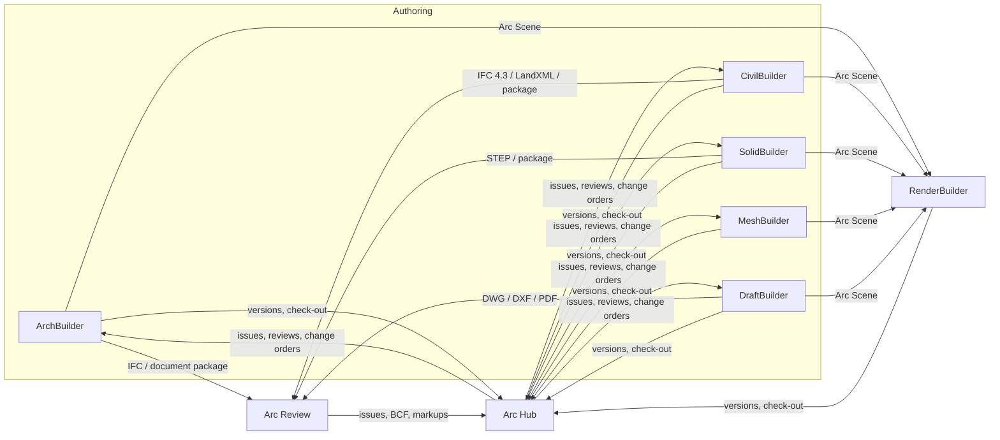

# Products

The product map: what each Arc product owns, who uses it, which document it writes, and how work
passes between products. Detailed capabilities are specified in each product repository.

File extensions are provisional until the first format freeze of each product.

## Product summaries

### ArchBuilder

- **Scope:** BIM authoring. Project, site, building and storey structure; elements with categories,
  families, types and instances; levels, grids and reference planes; rooms, spaces and zones; phases
  and design options; views, sheets and schedules derived from one model; structural and
  building-services disciplines; concept massing with early analysis; steel detailing with
  fabrication outputs; a connector for native project files and families of other BIM
  applications; concept massing on tablets and in the browser.
- **Primary users:** architects, structural engineers, building-services engineers, steel
  detailers, BIM coordinators.
- **Native document:** `.archb` (Arc document package).
- **Repository:** [archbuilder](https://github.com/ACKaraca/archbuilder)

### DraftBuilder

- **Scope:** general-purpose 2D drafting and 3D CAD whose native data model is the DWG/DXF drawing
  database: model space and layouts, symbol tables, blocks, external references, annotation,
  constraints, tables, plotting, sheet sets, 3D solids and meshes, and a keyboard-first command
  line. Optional toolsets add discipline objects for architecture, mechanical, building services,
  electrical controls, plant, mapping and raster work. Open readers for DGN V7 and 3DM; embedded
  objects through operating-system object linking and an automation bridge on Windows; video output
  of camera animations through RenderBuilder; browser and mobile builds for viewing, measuring,
  markup and editing.
- **Primary users:** drafters and CAD technicians in every discipline, engineers producing details.
- **Native document:** `.dwg` and `.dxf` saved directly; `.draftb` package for sidecar data (toolset
  object data, history, review state) that the drawing database cannot hold.
- **Repository:** [draftbuilder](https://github.com/ACKaraca/draftbuilder)

### CivilBuilder

- **Scope:** civil infrastructure design: survey data, terrain surfaces, alignments and profiles,
  assemblies and corridors, intersections, sections and quantities, earthworks, grading, parcels,
  gravity and pressure networks with hydraulic analysis, rail, bridges, plan production, concept
  infrastructure in a geospatial context, vehicle swept-path analysis, and a connector for the
  design objects of native civil drawings of other applications.
- **Primary users:** civil engineers, surveyors, transportation and drainage designers.
- **Native document:** `.civilb` (Arc document package).
- **Repository:** [civilbuilder](https://github.com/ACKaraca/civilbuilder)

### SolidBuilder

- **Scope:** parametric mechanical design: sketches with constraints, feature history, multi-body
  parts, surfacing, freeform subdivision modeling, sheet metal, weldments, routed systems, standard
  parts library, assemblies with joints and motion, configurations, bills of materials, associative
  drawings with tolerancing, rule-based automation, manufacturing preparation, simulation through
  open solvers, topology optimization, and an electronics design workspace (schematic capture, PCB
  layout, design-rule checking, routing, circuit simulation and manufacturing outputs) alongside
  exchange with open electronics design tools; connectors for native mechanical CAD files, with
  feature trees where the host API exposes them.
- **Primary users:** mechanical engineers, product designers, manufacturing engineers.
- **Native document:** `.solidb` (Arc document package).
- **Repository:** [solidbuilder](https://github.com/ACKaraca/solidbuilder)

### MeshBuilder

- **Scope:** digital content creation: scene graph, polygon and subdivision modeling with a
  non-destructive modifier stack and node graph, curves, sculpting, retopology, UV editing, texture
  painting and baking, look development, rigging, animation, motion-capture editing, simulation and
  motion graphics, and OpenUSD scene assembly; connectors for native scene files and pipeline
  integrations inside other content tools; third-party renderers through out-of-process Hydra render
  delegates.
- **Primary users:** 3D artists, animators, riggers, technical directors, visualization artists.
- **Native document:** `.meshb` (Arc document package).
- **Repository:** [meshbuilder](https://github.com/ACKaraca/meshbuilder)

### RenderBuilder

- **Scope:** physically based production rendering: path tracing, OpenPBR materials, lights,
  cameras, AOVs, denoising, color management, an interactive render view, a command-line renderer
  and render-farm worker, and a node-based material editor. It renders for every other product
  through the Arc Scene contract, and inside other content-creation applications through a Hydra
  render delegate and host integrations.
- **Primary users:** look-development and lighting artists, visualization artists, and every Arc
  user who needs photoreal output.
- **Native document:** `.renderb` (Arc document package holding render settings, look files and
  scene references).
- **Repository:** [renderbuilder](https://github.com/ACKaraca/renderbuilder)

### Arc Review

- **Scope:** model and drawing aggregation and review: federation of models from many formats,
  property inspection, search and selection sets, sectioning, viewpoints, measurement, markup, clash
  detection, rule-based model checking, 4D sequencing, 5D cost, quantity takeoff, model and drawing
  comparison, batch conversion, a free read-only mode, a browser viewer, a mobile build, immersive
  multi-user XR review, and export from authoring applications through connectors with switch-back
  to them.
- **Primary users:** BIM coordinators, construction managers, cost estimators, clients and anyone who
  reviews without authoring.
- **Native document:** `.arcrev` (Arc document package holding a federation: references to source
  models, alignment, viewpoints, rules, clash results, markups).
- **Repository:** [arc-review](https://github.com/ACKaraca/arc-review)

### Arc Hub

- **Scope:** self-hostable collaboration and data management: document management with versions,
  lifecycle states, reviews, approvals, transmittals and issues; design collaboration packages and
  multi-user editing sessions; product data with items, revisions, bills of materials and change
  orders; production tracking; a platform API, webhooks and automation jobs that run headless Arc
  applications; pipeline integrations inside other applications built on the connectors; native
  mobile clients for documents, issues and markups with offline field use; browser authoring that
  opens the browser build of the owning product.
- **Primary users:** project, document and data managers, production coordinators, every team
  member who shares work.
- **Native document:** none; Hub stores Arc documents and other files and holds its own database.
- **Repository:** [arc-hub](https://github.com/ACKaraca/arc-hub)

### Foundation

`arc-core` is not a product. It provides the shared crates every product builds on; see
[architecture overview](architecture/overview.md#arc-core-layers).

### Connectors

`arc-connectors` is not a product either. It holds the connectors: add-ins that run inside the
user's licensed copy of another application, use only that application's official public API, and
read or write the Arc exchange package. The repository is created with the first connector
([ADR-0017](adr/0017-exchange-connectors-and-licensed-bridges.md)).

## Boundaries and hand-offs

The rule for every boundary: **the product that authors an object owns it.** Other products
reference, view, check or render it, and send changes back as issues or markups, never by editing a
copy that becomes a second source of truth.

| Hand-off | From | To | Carried by | Owner of the data after the hand-off |
|---|---|---|---|---|
| Design model to coordination | ArchBuilder, CivilBuilder, SolidBuilder | Arc Review | Document package or IFC/STEP, referenced, not copied | Authoring product |
| Drawings to review | Any product producing sheets | Arc Review, Arc Hub | PDF, DWG, sheet sets from the document package | Authoring product |
| Review findings back to authors | Arc Review | Authoring product, through Arc Hub | Issues with viewpoints and element identifiers; BCF | Arc Hub issue record |
| Any model to photoreal output | Any authoring product | RenderBuilder | Arc Scene contract, streamed over local IPC or written to disk | Scene: authoring product; looks and render settings: RenderBuilder document |
| Shared 2D documentation | Every product | — | `arc-draft` model in `arc-core`; DraftBuilder is its full editor | The document in which the drafting objects live |
| Architectural model to civil site | ArchBuilder | CivilBuilder | Building footprint, levels and site connection points as a shared reference | ArchBuilder |
| Terrain and site to building design | CivilBuilder | ArchBuilder | Surface and site data as a shared reference or IFC 4.3 | CivilBuilder |
| Mechanical equipment into buildings | SolidBuilder | ArchBuilder | Simplified representation with connectors, exported as a loadable family or IFC | SolidBuilder |
| Engineering model to content | ArchBuilder, SolidBuilder | MeshBuilder | Live reference through the document package, or OpenUSD export | Authoring product; MeshBuilder owns only its overrides |
| Released data to product management | SolidBuilder | Arc Hub | Check-in of parts, assemblies, drawings and bill of materials | Arc Hub item and revision record |
| Headless jobs | Arc Hub | Any product's CLI | Automation protocol; job definitions | Hub job record; output document versions |
| Exchange with other applications | A connector inside another application, or an Arc product | An Arc product, or the other application | Arc exchange package ([ADR-0017](adr/0017-exchange-connectors-and-licensed-bridges.md)) | The application in which the data is authored; source identifiers are mapped in both directions |

## Responsibility matrix

Several products touch the same kind of work. The matrix states who **owns** (authors and is the
source of truth), who **contributes** (produces a domain-specific part), and who **consumes** (views,
checks or uses without authoring).

| Area | Owns | Contributes | Consumes |
|---|---|---|---|
| 2D documentation (drawings, details, sheets, plotting) | `arc-draft` engine in `arc-core`; DraftBuilder for stand-alone drawings and complete drafting editing | ArchBuilder, CivilBuilder, SolidBuilder generate views and sheets from their models through `arc-view` | Arc Review, Arc Hub |
| Visualization (photoreal stills, animation, panoramas, lighting studies) | RenderBuilder | MeshBuilder for look development and animated content; authoring products export Arc Scenes | Arc Review, Arc Hub (review playlists) |
| Real-time visualization | `arc-gpu` in `arc-core` | Every product | — |
| Structural and steel | ArchBuilder (structural elements, analytical model, reinforcement, connections, steel detailing) | SolidBuilder for custom fabricated parts; DraftBuilder for detail sheets | Arc Review (checking), Arc Hub (fabrication release) |
| Terrain | CivilBuilder (survey, surfaces, grading) | ArchBuilder consumes and adjusts site elements through shared references; MeshBuilder may add visualization detail | Arc Review, RenderBuilder |
| Quantity takeoff | Arc Review for federated and 2D takeoff across models; each authoring product for schedules and quantities of its own model | CivilBuilder for earthwork volumes and corridor quantities; SolidBuilder for bills of materials | Arc Hub (cost and product data) |
| Data management (versions, approvals, revisions, items) | Arc Hub | Every product through the Hub API | — |
| Clash detection and model checking | Arc Review | Authoring products run their own validation rules before publishing | Arc Hub (automatic clash runs and issues) |
| Interchange format reading and writing | `arc-io-*` crates in `arc-core` (neutral format model) | Each product maps formats into its domain model | — |
| Exchange with other applications | Arc exchange package in `arc-core`; connectors in `arc-connectors` | Each product maps the package into its domain model; Arc Hub builds pipeline integrations on the connectors | — |
| Browser and mobile builds | The product that owns the document | `arc-ui` and `arc-app` for touch, small screens and platform integration | Arc Hub opens browser builds for browser authoring |
