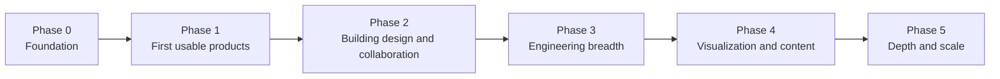

# Roadmap

The suite phases, their goals, the foundation and product work in each, the dependencies between
repositories, and the exit criteria that end each phase. Phases end when their exit criteria are
met; there are no dates. Each product roadmap maps its milestones onto these phases.

## Overview

Phases describe where the suite's emphasis lies. Work for a later phase may start earlier when its
dependencies are met; a phase is complete only when its exit criteria are met.

Optional assistance follows its own [assistance track](#assistance-track) across the phases. Its
checks never gate a phase exit, because no product feature depends on assistance.

## Phase 0: Foundation

**Goal.** A foundation that every product can build on, proven by a reference shell application.

| Repository | Work |
|---|---|
| `arc-core` | `arc-base`; `arc-geom` 2D minimum; `arc-doc` (store, transactions, journal, dependency graph, package); `arc-command` (registry, prompt machines, automation protocol endpoint, headless runner); `arc-gpu` minimum viewport (lines, meshes, picking, camera-relative precision); `arc-ui` and `arc-app` minimum (docking, command line, palette, property grid, localization, settings); reference shell application and CLI |
| `arc-suite` | Ratified ADRs; reusable CI workflows; release pipeline; agent-rules synchronization check |
| All repositories | Repository settings, labels, board, `AGENTS.md`, CI gate in place |

**Dependencies.** None.

**Exit criteria.**

- A user opens the reference shell application, creates a document, draws and edits simple geometry
  in the viewport with mouse and keyboard, undoes and redoes every step, saves, closes and reopens the
  document with identical content.
- Ending the process during editing and restarting recovers the unsaved work from the recovery
  journal.
- The same edits run from the headless CLI and through the automation protocol from a Python script
  produce an identical document.
- `cargo xtask layers` fails a build that adds a UI dependency to an L3 crate.
- The layers L0 to L3 build for WebAssembly.
- The release pipeline produces signed, checksummed artifacts of the reference shell application on
  all primary platforms from a tag.
- Every panel of the shell application passes its accessibility-tree tests and renders in the Turkish
  catalogue and the pseudo-locale.

## Phase 1: First usable products

**Goal.** Two products that professionals can use for real work: 2D drafting and model viewing.

| Repository | Work |
|---|---|
| `draftbuilder` | 2D core: draw, modify, annotate, layers, blocks, layouts, plotting, DXF read and write, DWG read |
| `arc-review` | Viewer: open, navigate, measure, section, markup; IFC, DXF/DWG, glTF and STEP |
| `arc-core` | `arc-draft`; `arc-io-dxf`, `arc-io-dwg` (read), `arc-io-ifc` (read), `arc-io-mesh`, `arc-io-pdf` (output); `arc-brep` first operations and STEP read through the B-rep tier; plot pipeline |
| Corpora | `arc-corpus-dxf`, `arc-corpus-dwg`, `arc-corpus-ifc` with admission rules |

**Dependencies.** Phase 0 exit; DWG read depends on `arc-io-dwg`; STEP viewing depends on the B-rep
tier.

**Exit criteria.**

- A drafter produces a dimensioned, annotated multi-sheet drawing set in DraftBuilder, plots it to PDF
  at scale, saves it as DXF, and the file opens in an independent DXF reader with no reported errors.
- A DWG drawing from the corpus opens in DraftBuilder with a loss report listing every unsupported
  object, and with unsupported objects preserved.
- A reviewer opens an IFC model, a DWG drawing and a STEP assembly together in Arc Review, aligns
  them, measures distances, places a section, creates markups and saves the federation.
- Fuzzing of the DXF, DWG and IFC readers has run with no open crash findings.
- DraftBuilder and Arc Review ship as an alpha suite release on one `arc-core` tag.

## Phase 2: Building design and collaboration

**Goal.** Building information modeling and file-level collaboration.

| Repository | Work |
|---|---|
| `archbuilder` | Architectural core: datum objects, walls, openings, floors, roofs, stairs, families, views, sheets, schedules, IFC import and export |
| `arc-hub` | Documents module: projects, permissions, versions, check-out, lifecycle states, reviews, issues, web viewer |
| `draftbuilder` | DWG write |
| `arc-review` | WebAssembly build of the viewer for Arc Hub; BCF |
| `arc-core` | `arc-view` (plans, sections, elevations, hidden lines); `arc-solve` first sketch constraints; `arc-hub-api`; `arc-io-bcf`; IFC write |

**Dependencies.** Phase 1 exit; ArchBuilder depends on `arc-view`, `arc-draft` and the B-rep tier;
the Hub web viewer depends on the Arc Review WebAssembly build.

**Exit criteria.**

- An architect models a two-storey building with walls, doors, windows, floors, a roof and a stair,
  produces plans, sections, elevations, a door schedule and sheets, and every view updates after a
  wall is moved.
- The model exports to IFC 4, the export passes schema validation in an independent reader, and
  re-import into ArchBuilder reports no losses for modeled elements.
- A team uploads the model to a self-hosted Arc Hub, checks it out and in, moves it through review
  and approval, and a reviewer opens it in a browser and raises an issue that appears in ArchBuilder
  with its viewpoint.
- DraftBuilder saves DWG drawings that reopen in DraftBuilder and in an independent reader with no
  errors.

## Phase 3: Engineering breadth

**Goal.** Mechanical and civil design, coordination at scale, product data management.

| Repository | Work |
|---|---|
| `solidbuilder` | Sketches, features, assemblies, drawings, STEP |
| `civilbuilder` | Surfaces, alignments, profiles, corridors, grading |
| `arc-review` | Clash detection, 4D sequencing, quantity takeoff |
| `arc-hub` | Product data module: items, revisions, bills of materials, change orders |
| `arc-core` | `arc-brep` persistent naming and modeling operations; `arc-solve` 3D constraints; `arc-io-geo` (CRS, LandXML, GIS); `arc-nodes` |

**Dependencies.** Phase 2 exit; SolidBuilder depends on persistent naming in `arc-brep`; CivilBuilder
depends on TIN surfaces in `arc-geom` and `arc-io-geo`.

**Exit criteria.**

- An engineer models a part from constrained sketches and features, changes a driving dimension, and
  every downstream feature and the associative drawing update without broken references; the part
  exports to STEP AP242 and re-imports with matching volume.
- A civil engineer builds a corridor from a surface, alignment, profile and assembly, edits the
  alignment, and sections and earthwork quantities update.
- A coordinator federates building, civil and mechanical models in Arc Review, runs clash detection,
  groups results, assigns them as issues through Arc Hub, and sees the status return from the
  authoring products.
- A released assembly is checked into Arc Hub with its bill of materials, and a change order produces
  a new revision.

## Phase 4: Visualization and content

**Goal.** Photoreal rendering, content creation and discipline depth.

| Repository | Work |
|---|---|
| `renderbuilder` | Path tracer, materials, interactive render view |
| `meshbuilder` | Modeling, UV editing, rigging, animation |
| `archbuilder` | Structure and building services |
| `draftbuilder` | Discipline toolsets |
| `arc-hub` | Production tracking |
| `arc-core` | `arc-scene` and the Arc Scene contract; `arc-mesh` subdivision; `arc-io-usd` |

**Dependencies.** Phase 3 exit for engineering inputs; RenderBuilder depends on the Arc Scene
contract; MeshBuilder depends on `arc-mesh` and `arc-io-usd`.

**Exit criteria.**

- A user starts an interactive render of an ArchBuilder model from inside ArchBuilder; moving a wall
  updates the render, and closing the renderer never affects the model.
- The CPU reference integrator matches the conformance scenes within the stated image-comparison
  thresholds.
- An artist models, unwraps, rigs and animates a character in MeshBuilder, exports it to OpenUSD, and
  renders the animation in RenderBuilder from the command line.
- A structural engineer and a services engineer add framing, ducts and pipes to an architectural
  model, and the coordinated model passes clash detection in Arc Review.

## Phase 5: Depth and scale

**Goal.** Element-level multi-user editing and the advanced capabilities of every product.

| Repository | Work |
|---|---|
| `arc-hub`, `arc-core`, authoring products | Element borrowing and change sets (collaboration stage 2) |
| `solidbuilder` | Manufacturing preparation and simulation; electronics design workspace; native finite-element, meshing, slicing and multi-axis toolpath kernels that replace the wrapped external engines once they pass the same validation suites |
| `meshbuilder` | Sculpting and effects; third-party renderers through out-of-process Hydra render delegates |
| `civilbuilder` | Networks, rail and hydraulics |
| `arc-review` | XR review; mobile build; export from authoring applications through connectors and switch-back |
| `renderbuilder` | GPU path tracing; Hydra render delegate and host integrations for other content-creation applications |
| `draftbuilder` | Browser and mobile builds; open readers for DGN V7 and 3DM; embedded objects and the automation bridge on Windows; video output of camera animations through RenderBuilder |
| `archbuilder` | Concept massing on tablets and in the browser |
| `arc-hub` | Native mobile clients with offline field use; browser authoring through product browser builds; pipeline integrations built on the connectors |
| `arc-connectors` | Connectors for native project files of BIM, mechanical CAD, civil and content-creation applications |
| `arc-core` | Arc exchange package and its conformance suite; browser and mobile support in `arc-ui` and `arc-app` |
| All products | Assistant workflows |

**Dependencies.** Phase 4 exit; stage 2 collaboration depends on the operation journal and the Hub
API change-set endpoints; GPU path tracing depends on the CPU reference integrator for parity tests;
connectors depend on the Arc exchange package; browser and mobile builds depend on touch and
small-screen support in `arc-ui`; a native engine replaces a wrapped one only after passing the
validation suite the wrapped engine passes.

**Exit criteria.**

- Two users edit one ArchBuilder model at the same time through Arc Hub; each sees the other's
  changes after synchronization; an offline edit to a contested element is kept as an alternate and
  resolved without losing either version.
- A machinist generates and simulates a 3-axis program for a SolidBuilder part and posts it to a
  documented controller format.
- GPU and CPU renders of the conformance scenes match within thresholds on hardware from more than
  one GPU vendor.
- A reviewer group meets in an XR session around a federated model and records issues that appear in
  Arc Hub.
- A user asks the assistant to perform a multi-step modeling task, reviews the previewed commands and
  applies them as one undoable transaction, with no document content sent until confirmed.
- A model authored in another BIM application is transferred to ArchBuilder through a connector,
  edited, and transferred back; identifiers are kept in both directions and each transfer produces a
  loss report.
- A user opens a drawing from Arc Hub on a tablet without a connection, measures and marks it up,
  and the markups appear in DraftBuilder on a workstation after synchronization.
- An engineer captures a schematic in SolidBuilder, lays out and routes the board, passes design-rule
  checking and writes manufacturing outputs.

## Assistance track

Assistance is introduced level by level as the surfaces it stands on exist
([assistance](architecture/assistance.md),
[ADR-0019](adr/0019-assistance-levels-grounding-and-deterministic-checking.md)). Each product places
its assistance capabilities in its own roadmap, after its manual workflows for the same task are in
place. The checks below are acceptance checks of the track, not phase exit criteria.

| Phase | Foundation and suite work | Product work | Acceptance check |
|---|---|---|---|
| 0 | RFC on [ADR-0019](adr/0019-assistance-levels-grounding-and-deterministic-checking.md) and [ADR-0020](adr/0020-assistant-provenance-and-command-policy.md); task-suite format and replay mode specified | None | The command catalog of the reference shell lists every command with its side-effect class, from which a command policy can be derived |
| 1 | Read-only Model Context Protocol endpoint, preview runs, query, selection and view-render methods in `arc-command`; replay-mode task runner in the headless CLI | DraftBuilder and Arc Review expose their audits and checks as read-only checker commands and keep A1 task suites | An external assistant client answers questions about a DraftBuilder drawing through the read-only endpoint, citing objects that select when opened, and the replayed task suite passes in continuous integration with no network access |
| 2 | Assistant host and panel in `arc-app` for levels A1 to A3; provider adapters; send preview, redaction and the assistance log; attach mode with approval; origin and provenance records once ADR-0020 is accepted | DraftBuilder A1 to A3; Arc Review A1; ArchBuilder checkers and task suites | A drafter asks for door dimensions on a sheet, reviews the proposal with checker findings, applies part of it as one undo step, and history shows the transaction with its assistant origin |
| 3 | A4 runs through the headless CLI and Hub jobs with budgets; hand-off notes in exchange packages and Hub issues | ArchBuilder A1 to A3; Arc Review clash grouping and issue drafting; Arc Hub permission-aware questions; SolidBuilder and CivilBuilder checkers and task suites | A coordinator asks Arc Review to group the clashes of a run, accepts the grouping, and the issues created in Arc Hub carry provenance marks until a person reviews them |
| 4 | Hand-off notes resolve objects across exchange packages; image input for checkers that compare views | SolidBuilder and CivilBuilder A1 to A3; MeshBuilder and RenderBuilder A1 and A2 | A civil engineer asks for alignment options under the project's design criteria and each option is shown with the criteria checker's findings before any is applied |
| 5 | Proposals and provenance in change sets during multi-user editing; agent runs over several products through external clients | Readiness class R2 capabilities across products; A4 runs | The phase 5 exit criterion on a multi-step assisted task, and an A4 run over a set of documents whose result is merged only after review |
